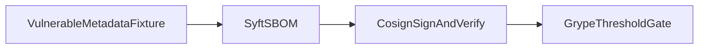

1. SBOM, signing, vulnerability gate, shown blocking a bad dependency.

2. Result:
   SBOM components: 2  
   Signatures verified: 1  
   Vulnerability matches: 11  

   Measured with `make bench`: [raw results](evidence/bench.json), [command output](evidence/checks.log), [environment](evidence/environment.json).

3. Architecture:


4. Run it:
```sh
make setup
make lint test bench
make demo
```

5. Decisions and limits: The vulnerable urllib3 version exists only as scanner metadata, never as installed/executed package code. Syft inventories it, cosign signs and verifies the actual SBOM using an ephemeral local key, and grype must return a vulnerability-threshold failure with matches. Private signing keys are temporary and are never committed. Local offline signing deliberately omits transparency-log upload; this demonstrates artifact integrity, not identity-backed production provenance. Grype database availability is required. See evidence/gate-failure.log, evidence/grype.json and evidence/verification.log. Reverify with .cache/bin/cosign verify-blob --key evidence/cosign.pub --signature evidence/sbom.sig --insecure-ignore-tlog evidence/sbom.cdx.json.

6. Next: Add keyless CI identity, provenance attestations and a passing patched dependency comparison.
